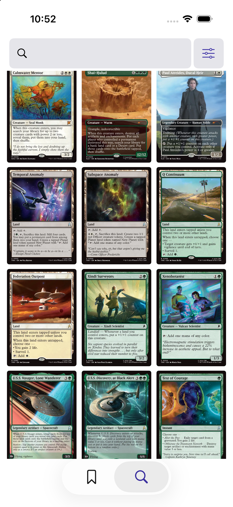
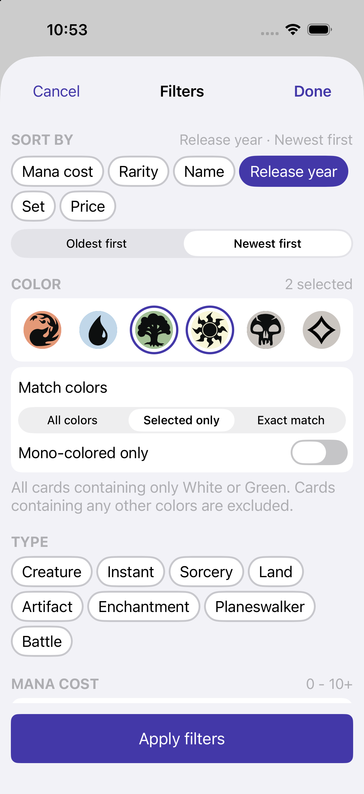
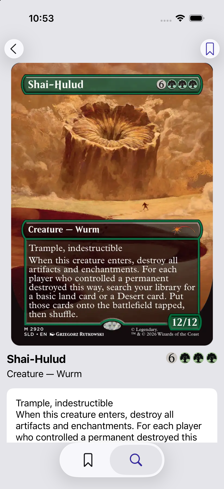
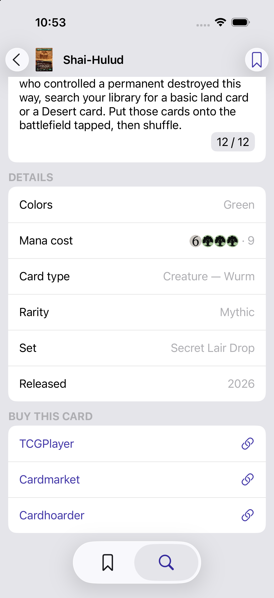
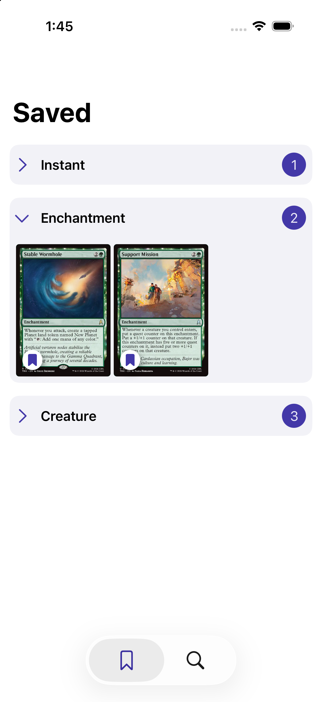

# MTG Card Finder

An iOS app for searching every Magic: The Gathering card. You can filter results, view card details, and save your favorite cards. Card data comes from the [Scryfall API](https://scryfall.com/docs/api).

<p align="center">
  
  
  
  
  
</p>

## Features

- **Search** the full Magic card catalog and browse results in a card grid.
- **Filter** by color, card type, mana cost, and more:
  - Color matching modes: *All colors*, *Selected only*, or *Exact match*, plus a mono-colored toggle
  - Card types: Creature, Instant, Sorcery, Land, Artifact, Enchantment, Planeswalker, Battle
  - Mana cost range from 0 to 10+
- **Sort** by mana cost, rarity, name, release year, set, or price, oldest or newest first.
- **Card details** show the full card image, mana cost, rules text, power/toughness, colors, rarity, set, and release year.
- **Save favorites** with the bookmark button. Saved cards are grouped by card type in collapsible sections.
- **Buy links** open the card on TCGPlayer, Cardmarket, or Cardhoarder.

## Tech Stack

- Swift and UIKit
- [Scryfall REST API](https://scryfall.com/docs/api) for card data and images

## Running the App

**Requirements:** a Mac with Xcode 27.2 or later. The app targets iOS 26.2.

1. Clone the repo:
   ```bash
   git clone https://github.com/<your-username>/<repo-name>.git
   ```
2. Open `MTG Card Finder.xcodeproj` in Xcode.
3. Choose an iPhone simulator (for example, iPhone 17 Pro) from the device menu in the toolbar.
4. Press **⌘R** to build and run.

You don't need an API key or any other setup. Scryfall's API is public, so the app works as soon as it launches. If the project uses Swift packages, Xcode fetches them automatically the first time you open it.

## Disclaimer

MTG Card Finder is unofficial Fan Content permitted under the Wizards of the Coast Fan Content Policy. It is not approved or endorsed by Wizards of the Coast. Magic: The Gathering and card images are property of Wizards of the Coast LLC. Card data is provided by [Scryfall](https://scryfall.com).
